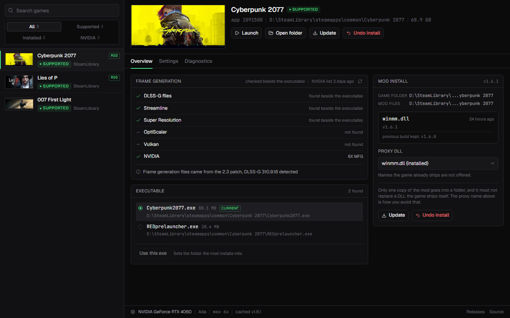
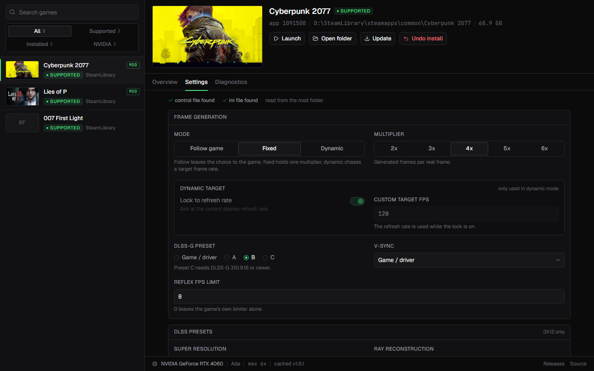
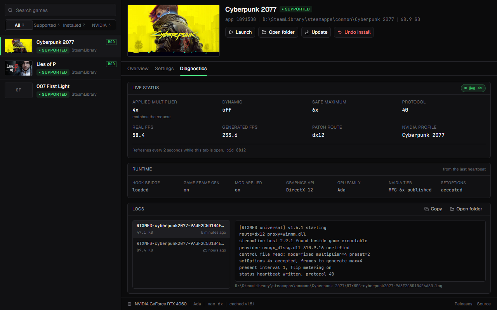

# MFG Unlocker GUI

A Windows front end for [MFG Unlocker](https://github.com/dashdogy/MFG-Unlocker), the mod that
unlocks DLSS Multi Frame Generation in games and adds controls the game itself never exposes.

The mod is a proxy DLL: you rename it, copy it beside the game executable and edit a JSON file to
change a preset. This app does that part. It scans Steam, decides which of your games the mod can
hook, installs and updates the DLL for you, edits the mod's settings while the game is closed, and
shows what happened the last time a game ran. The mod itself is not bundled; the app downloads it
from the mod's releases and checks the published SHA-256 before copying anything into a game folder.



## What it does

- Finds Steam through the registry, reads every library folder Steam knows about, and lists the
  games that are actually installed, not the ones that are only in your account.
- Picks the executable the mod should sit next to. This matters: the mod's files live beside the game
  binary, so an Unreal game ends up in `Binaries\Win64`, not in the game root.
- Checks whether a game can take the mod by looking for the DLLs the mod hooks, and cross checks
  NVIDIA's published per-title list on top of that.
- Installs the mod DLL under a proxy name that is free in that folder, takes care of the Bink route
  when a game links Bink video, and refuses to overwrite anything the game ships.
- Undoes an install completely: removes the DLL, gives the game's own Bink DLL its name back, and
  restores the mod build that was replaced.
- Checks the mod's releases on startup, downloads a new build, and moves every installed game to it.
- Edits all of the mod's settings from outside the game: mode, multiplier, dynamic target, the three
  preset families, V-Sync, the Reflex FPS cap, menu language and key, and the two compatibility
  switches.
- Reads the mod's live status file and runtime logs, which is how you find out whether the mod
  actually attached inside a game.
- Keeps everything in one folder next to its own exe: no installer, no AppData, no registry writes.
- Remembers its window position and size, and has a UI zoom control for small monitors.

## Why a front end exists

The mod's own [README](https://github.com/dashdogy/MFG-Unlocker#install) explains the manual route:
close the game, rename `MFGUnlocker.dll` to a DLL name the game loads early, place it beside the
actual game executable, launch the game, press Backspace for the in-game menu, then edit
`RTXMFG-Universal.json` or `RTX40MFG-UI.ini` by hand for anything the menu does not expose. Every step
has a trap: the wrong proxy name means the mod is never loaded, the wrong folder means it is loaded
from a launcher nobody reads, and a stray `version.dll` in the game folder is exactly how players
break games.

This app keeps the record of what it changed (`data\store.json`) so installing, updating and undoing
are all reversible, and it only writes files it can name.

## First run

1. Take the executable from the [latest release](../../releases/latest) (or build it yourself) and
   put it in a folder you can write to. A Program Files folder needs administrator rights, which the
   app does not ask for.
2. Run it. The first scan reads your Steam libraries and takes a few seconds on a 600 game library.
3. The app checks the mod's releases and downloads the current build into `data\release` before you
   install anything.
4. Pick a game on the left, then press **Install** and choose a proxy name.

## The game list

### How Steam is found

No paths are hardcoded. The app tries, in order:

1. `HKCU\Software\Valve\Steam`, value `SteamPath`
2. `HKLM\SOFTWARE\WOW6432Node\Valve\Steam`, value `InstallPath`
3. `HKLM\SOFTWARE\Valve\Steam`, value `InstallPath`, including the 32-bit registry view
4. `%ProgramFiles(x86)%\Steam`, and the literal `C:\Program Files (x86)\Steam` as a last resort

A candidate is only accepted if the folder exists. Libraries come from
`steamapps\libraryfolders.vdf`, both the modern layout (`"0" { "path" "D:\SteamLibrary" }`) and the
old one where the number maps straight to a path. Installed games come from
`steamapps\appmanifest_<appid>.acf`: the app needs `StateFlags` bit 4 (fully installed) and an
existing `steamapps\common\<installdir>` folder, and it skips the Steamworks redistributables.

### Choosing the executable

The scan walks up to four levels deep, stops after 4000 directories, skips content, movie, audio,
redist, EasyAntiCheat and BattlEye folders, and keeps `.exe` files of at least 512 KB. It then scores
the survivors: a name matching the game or folder wins, `-Shipping` and `Win64` get a bonus, anything
called launcher gets pushed down, and file size only breaks ties. Up to 24 candidates are kept and you
can pick another one in the app, which moves the install target with it.

### Games outside Steam

**Add game** takes any folder. The same probe runs, the folder is remembered, and the entry disappears
if the folder is renamed or removed.

## Compatibility

Two independent checks are shown side by side. Neither is a guarantee, and both are one glance away
from the real answer, which is the status file after a launch.

### The files the mod hooks

The scan looks in the folder of the chosen executable, its parent and its grandparent:

| Found | Meaning |
| --- | --- |
| `nvngx_dlssg.dll` or `sl.dlss_g.dll` | the game ships DLSS Frame Generation |
| `sl.interposer.dll` or `sl.common.dll` | the game ships NVIDIA Streamline |
| `nvngx_dlss.dll` | DLSS Super Resolution only, no frame generation |
| `vulkan-1.dll` | a Vulkan runtime, where DirectX proxy names may not be loaded |
| `OptiScaler.ini` or `OptiScaler.dll` | OptiScaler is installed here, which changes the install route |

Frame generation plus Streamline reads as **supported**. Frame generation alone reads as **likely**,
because the mod can often attach to a statically linked integration too. Streamline without frame
generation reads as **no frame gen**, and nothing found reads as **unknown** unless NVIDIA's list says
otherwise.

### NVIDIA's list

NVIDIA publishes a per-title table of DLSS overrides, including the Multi Frame Generation multiplier
they allow. The app downloads it once a week into `data\nvidia-overrides.json` and matches your game
names against it, with a tolerance for edition suffixes. The small refresh icon beside the list age in
the Overview tab fetches it again on the spot, then rescans so the tiers are current.

| Tier | Meaning |
| --- | --- |
| 6X MFG | NVIDIA publishes a 6x ceiling for the title |
| 4X MFG | NVIDIA publishes a 4x ceiling |
| Frame Generation, no MFG override | frame generation is listed, but no MFG multiplier |
| not listed | no entry, so the multiplier comes from the game's own integration |

When the local probe finds no DLSS files but NVIDIA does list the title, the state becomes **likely**
and a note says so: the plug-in probably comes from the NVIDIA app rather than the game folder. That
case is common and it is why the list is worth having.

## Installing the mod

### Proxy names

A DLL only gets loaded if something imports it by name, so the mod masquerades as a DLL the game
already loads and forwards the real calls. The mod supports 19 names (`version.dll`, `winmm.dll`,
`dinput8.dll`, `dxgi.dll`, `wininet.dll`, `winhttp.dll`, `dsound.dll`, the `d3d9`/`d3d10`/`d3d11`/
`d3d12` family, the `xinput` family, and the two Bink DLLs).

The picker only offers names that can work in that folder:

- **free** names, where nothing exists at that path, listed as plain filenames
- the name this app already installed, marked `(installed)` and selected first
- Bink names, marked `(bink route)`, and only when the game ships that DLL

Names the game already occupies are not offered at all, and the app refuses to write over a file it
did not put there.

### The Bink route

Games that play Bink video import `binkw64.dll` or `bink2w64.dll` from their own folder, early in
startup, which makes it a reliable hook point when nothing else is free. Since only one file can hold
that name, the app moves the game's copy to `binkw64Hooked.dll`, puts the mod under the original name,
and the mod loads the renamed DLL back so video keeps working. Undo reverses both steps.

There is nothing to back up for a free name, because nothing was there.

### Update and undo

Every install records what it wrote and what it replaced. **Update** installs the newest downloaded
build over the current one, keeping the replaced build in `data\backups\<hash>\`. **Undo install**
removes the proxy DLL, restores the game's Bink DLL, and puts the replaced mod build back if there was
one, then refreshes the card. Settings files and logs are never deleted by an undo: they are the
mod's own data, and losing a tuned config to an uninstall would be rude.

A confirmation dialog spells out exactly which files are removed and which are restored before
anything touches the folder.

### Automatic updates

On startup, after the first scan settles, the app checks the mod's GitHub releases, downloads the
newest `MFGUnlocker.dll` when it is not cached, verifies the zip against the asset digest GitHub
publishes, and replaces the DLL in every game that is behind. A game that is running holds its DLL
open, so it is skipped with a warning and picked up on the next launch. Every update keeps the
replaced build, so undo still works per game. A rescan also rechecks the cached release.

## Settings

Settings are written to `RTXMFG-Universal.json` (the mod's authoritative control file) and
`RTX40MFG-UI.ini` (menu preferences). Keys the app does not own, such as `xessModel` and
`optiScalerUi`, are preserved. Saves are atomic, with an in-place fallback when the game holds the
file open.



| Setting | Values | What it changes |
| --- | --- | --- |
| Mode | Follow game, Fixed, Dynamic | Follow keeps the game's own requested multiplier, Fixed holds one value, Dynamic chases a target frame rate |
| Multiplier | 2x to 6x | Generated frames per real frame, clamped at runtime by the provider and NVIDIA's per-title ceiling |
| Dynamic target | lock to refresh rate, or 30 to 1000 FPS | Only used in Dynamic mode; the lock option writes 0 to the control file |
| DLSS-G preset | Game / driver, A, B, C | C needs DLSS-G 310.9.16 or newer; applies live in DirectX 12 games, a Vulkan game needs a restart |
| V-Sync | Game / driver, Off, On | Off presents the game's frames without V-Sync; NVIDIA Control Panel settings still win |
| Reflex FPS limit | 0 to 1000 | 0 leaves the game's own limiter alone; unavailable while Dynamic is selected |
| Super Resolution preset | Game / driver, J, K, L, M | Switches live in DirectX 12 games without OptiScaler |
| Ray Reconstruction preset | Game / driver, D, E, F | F needs NVIDIA driver 580 or newer |
| Language | Auto, English, Chinese, Ukrainian, Italian, Swedish, Turkish, Vietnamese | Menu language only, diagnostics stay in English |
| Menu key | any single key | Stored as a Windows virtual key code; empty keeps the mod's default, Backspace |
| Pinned FPS | on, off | Small real and generated FPS readout in the corner while the menu is closed |
| Layout scale | number | Menu scale override, empty means the default |
| RTX 30 flip metering | Inherit, On, Off | Inherit removes the key so the mod's default applies (on); Off returns to the older pacing |
| GPU name override | on, off | RTX 30 only: the game is told it runs on an RTX 4090 and offers its DLSS Frame Generation option. Same switch as "Game FG option: Unlock" in the mod's menu; off by default |
| Interval logging | on, off | Extra per-frame timing lines in the runtime log |
| Generated-only debug | on, off | Mod debugging switch, leave off |

Saved settings apply the next time the game starts. The presets are the exception: the mod can swap
them while a DirectX 12 game runs.

## Diagnostics



The Live status block reads `RTXMFG-Universal.status.json`, which the mod rewrites while a game runs,
and refreshes every two seconds while the tab is open:

| Field | Meaning |
| --- | --- |
| Applied multiplier | what the running Frame Generation pipeline ended up with, and whether it matches the saved request |
| Dynamic | whether the mod is chasing a target frame rate right now |
| Safe maximum | the smallest of the provider's compiled capacity and NVIDIA's per-title ceiling |
| Protocol | the status file version the mod writes |
| Real FPS, generated FPS | measured rates; a wide gap is the point of MFG |
| Patch route | `dx12` or `vulkan`, whichever pipeline the mod hooked |
| NVIDIA profile | the profile NVAPI resolved for the running executable |

The Runtime block is the "did it actually attach" answer: hook bridge loaded, the game's frame
generation state, whether the mod applied its request, the graphics API, GPU family, NVIDIA tier and
the Streamline `setOptions` result code (0 is accepted).

The Logs block lists every `RTXMFG-*.log` in the mod folder, newest first. Each launch keeps the
previous runtime log as `.previous.log`, so a crash can be compared against the run before it. Logs
land beside the game executable, or in `%TEMP%` when the game folder is read only.

## Files and folders

Next to the game executable that you selected:

| File | Who owns it |
| --- | --- |
| the proxy DLL you picked | this app copies and removes it |
| `<name>Hooked.dll` | only on the Bink route: the game's own DLL, renamed, restored on undo |
| `RTXMFG-Universal.json` | the mod reads it at startup; this app edits it |
| `RTX40MFG-UI.ini` | menu preferences; this app edits the keys it exposes |
| `RTXMFG-Universal.status.json` | written by the mod while a game runs; this app only reads it |
| `RTXMFG-*.log` | written by the mod; this app only reads it |

Next to this app's own executable:

| File | Contents |
| --- | --- |
| `data\store.json` | the game list, chosen executables, install and undo metadata |
| `data\window.json` | last window position, size and maximized state |
| `data\release\` | downloaded mod builds and the release check cache |
| `data\backups\` | mod builds kept aside so an update or reinstall can be undone |
| `data\nvidia-overrides.json` | NVIDIA's per-title list, refreshed weekly |
| `data\steam-covers.json` | cover art URLs resolved from Steam's store API, refreshed monthly |
| `data\webview\` | the WebView2 profile, which also holds the UI zoom level |

## Portable

Everything the app keeps lives in that `data` folder, so copying the `.exe` together with the folder
moves the whole state. Nothing is written to AppData, nothing is written to the registry: Steam and
the graphics card are only read from there. There is no installer on purpose. Uninstalling the app
means deleting the exe and its data folder, after undoing the mod from each game.

## Requirements

- Windows 10 or 11 with the WebView2 runtime, which current Windows already has
- For DLSS MFG: an RTX 20, 30, 40 or 50 card. RTX 20 and RTX 30 are experimental in the mod itself
- The game needs a Streamline Frame Generation integration, or one supplied by the NVIDIA app. The
  mod's README has the per-game caveats
- XeSS MFG through OptiScaler works on NVIDIA, AMD and Intel cards, but that route is set up in
  OptiScaler, not here

## Build from source

Node 20 or newer with pnpm, Rust 1.82 or newer with the `x86_64-pc-windows-msvc` target, and the
Visual Studio C++ build tools for the linker.

```text
pnpm install
pnpm tauri dev      # development, opens the app window
pnpm tauri build    # release build, the exe lands in src-tauri/target/release
```

Bundling is off so the output is a single portable executable rather than an installer that writes to
Program Files and the registry. `pnpm dev` on its own runs the interface in a browser against fixture
data, which is useful for design work and does nothing to your games.

The Rust side lives in `src-tauri/src`: `steam.rs` reads Steam, `gamedir.rs` walks game folders,
`compat.rs` and `nvidia.rs` judge compatibility, `release.rs` handles GitHub, `install.rs` and
`store.rs` own install state and undo, `settings.rs`, `status.rs` and `winstate.rs` handle the files,
and `commands.rs` is the IPC layer. The UI is React and Tailwind in `src`.

## Troubleshooting

**The in-game menu never appears.** The chosen proxy name was not loaded by that game. Try another
free name, `winmm.dll` and `dinput8.dll` are the usual fallbacks. Vulkan games may not load DirectX
proxy names at all, and a launcher selected as the executable will not load anything the real game
does. If no `RTXMFG-*.log` shows up in the mod folder, the DLL never got loaded.

**The Frame Generation option is greyed out on an RTX 20 or 30 card.** The game may hide it on those
cards. Turn on **GPU name override** and restart the game: it reports the card as an RTX 4090, which
makes the option appear. It is off by default, it only does anything on RTX 30 cards, and the game
may then recommend settings for a 4090.

**An update was skipped.** The game was running and holding the DLL open. Close it and rescan; the
next scan updates it.

**Install or undo says the DLL is still in use.** A running game keeps the mod DLL mapped, and Windows
will not let anything replace or delete a mapped file. Close the game, then press the button again.
Nothing was changed by the failed attempt.

**Install says the folder needs administrator rights.** The game folder is not writable by your user,
so the app will not pretend the copy succeeded. Start the game folder from a writable library, or run
the app as administrator deliberately.

**The NVIDIA column is empty.** The list is fetched from NVIDIA's site once a week and cached. Without
a network connection and without a cached copy the column reads unavailable, and everything else keeps
working.

**Offline.** Scanning, uninstalling, editing settings, reading logs and installing from an already
cached build all work without a network. The release check and the NVIDIA list need one the first
time.

**Anti-cheat.** A proxy DLL in a game folder can look like a cheat to kernel anti-cheat. That risk
exists with the mod alone, and online games are the wrong place to test any of this.

## Credits and licence

CC0 1.0 Universal. To the extent possible under law, lashman has waived all copyright and related or
neighbouring rights to this work, so it is public domain: use it, change it, ship it, no attribution
needed. The full text is in [LICENSE](LICENSE).

- [MFG Unlocker](https://github.com/dashdogy/MFG-Unlocker) is the mod itself, MIT licensed. It is not
  included here. Its DLL embeds Intel XeSS program data under Intel's terms, which is why the app
  downloads it at run time instead of shipping it.
- NVIDIA's per-title DLSS override data is fetched from NVIDIA's own site.
- Built with [Tauri 2](https://tauri.app), React and Tailwind. Dependencies keep their own licences
  (MIT and Apache-2.0).

Not affiliated with the mod's author, NVIDIA or Intel.
